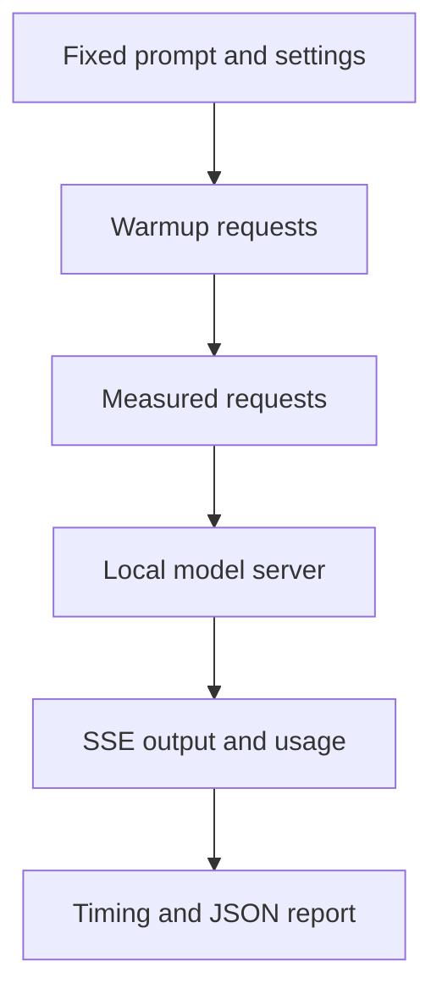

# Local LLM Engine Benchmark

Measure a local model server through streaming HTTP: time to first output,
end-to-end latency, server-reported token throughput, and speculative tokens per
target pass when available. Use the same prompt and request settings with Uzu,
MLX LM, and llama.cpp to compare complete application paths on your own hardware.

This is a standard-library measurement harness, not an inference engine. The
included synthetic stream validates HTTP parsing and measurement behavior without
downloading a model. Its timings and token counts are fixtures and must never be
reported as model, chip, or engine benchmark results.

## Code map

| File | Responsibility and connection |
| --- | --- |
| `benchmark.py` | Builds fixed chat requests, parses SSE, records wall-clock timing and server usage, discards warmups, and emits JSON reports. Used by the CLI and demo. |
| `synthetic_server.py` | Serves a fixed response in timed SSE chunks on loopback for an offline transport fixture. No inference occurs. |
| `demo.py` | Starts the synthetic server on a temporary port, runs the real benchmark client, prints the clearly labeled report, and closes the server. |
| `test_benchmark.py` | Tests actual HTTP timing, warmup exclusion, request consistency, usage absence, SSE records, and URL credential rejection. |
| `requirements.txt` | Records the Python version and zero external runtime dependencies. |



## Run offline

Requires Python 3.10 or later. Commands work on Windows, Linux, and macOS:

```sh
python demo.py
python -m unittest -v
```

For an independently running fixture:

```sh
python synthetic_server.py --port 8099
```

In another terminal:

```sh
python benchmark.py --engine synthetic --endpoint http://127.0.0.1:8099/v1/chat/completions --model synthetic-fixture --warmups 1 --runs 3
```

The fixture identifies itself with an HTTP header, so both the demo and generic
CLI label its reports `mode: synthetic`. Other endpoints are tagged `mode: live`.

## Run a real local comparison

Start **one engine at a time** so models do not compete for memory and bandwidth.
The harness itself works on any platform; Uzu and MLX model execution requires
compatible Apple hardware. Server installations and model downloads are separate.
No hosted model or hosted API key is required. If your local server requires
authentication, set `LOCAL_LLM_API_KEY` in its environment; the value is sent only
in the Authorization header and is never included in the JSON report.

For Uzu, the upstream repository documents the OpenAI-compatible server command
below, run from its checkout after completing its platform-specific build setup:

```sh
cargo run --release -p cli -- server --model trymirai/Qwen3.5-9B-M --port 8000
```

For installed MLX LM:

```sh
mlx_lm.server --model mlx-community/Qwen3.5-9B-4bit --port 8001
```

For installed llama.cpp (model downloads may be several gigabytes):

```sh
llama-server -hf unsloth/Qwen3.5-9B-MTP-GGUF:Q4_K_S --alias qwen3.5-9b-q4-k-s -ngl 99 -fa on -c 8192 -np 1 --port 8002
```

Run the matching client command while that engine is active:

```sh
python benchmark.py --engine uzu --endpoint http://127.0.0.1:8000/v1/chat/completions --model trymirai/Qwen3.5-9B-M --output results/uzu.json
python benchmark.py --engine mlx --endpoint http://127.0.0.1:8001/v1/chat/completions --model mlx-community/Qwen3.5-9B-4bit --output results/mlx.json
python benchmark.py --engine llama-cpp --endpoint http://127.0.0.1:8002/v1/chat/completions --model qwen3.5-9b-q4-k-s --output results/llama-cpp.json
```

Defaults are one discarded warmup and three measured runs, the merge-sorted-lists
prompt, temperature zero, a 1024-token cap, streaming usage, and a request to
disable thinking. Override the prompt and limit consistently with `--prompt` and
`--max-tokens`. Engine-specific chat templates may interpret optional fields
differently; inspect server logs and fix settings before interpreting results.
Temperature zero requests greedy sampling but does not guarantee identical text
across different engines, quantizations, or templates.

## Interpret the report

* `ttft_seconds`: request start to first nonempty content or reasoning event.
  Role-only and usage-only events do not count as output.
* `end_to_end_seconds`: full request wall time, including the stream ending.
* `end_to_end_tokens_per_second`: server completion tokens divided by wall time.
* `approximate_decode_tokens_per_second`: `(completion_tokens - 1)` divided by
  first-to-last output-event time. **Approximate** because a stream event can
  contain several tokens; it is not an engine-native decode measurement.
* `tokens_per_target_pass`: completion tokens divided by `spec_verify_ct` when
  that engine supplies the field. Missing usage produces `null`, never a token
  count guessed from characters or chunk counts.

The raw measured requests and their medians are retained together. Compare
hardware, power mode, context length, prompt, output limits, warmups and sampling
settings. Check response quality as well as latency. Different 4-bit conversions
use different quantization recipes; these commands compare complete engine paths,
not isolated kernels or the effect of speculation alone. Native server statistics
can differ from client rates because client rates include HTTP and stream delays.

## Upstream projects

* [Uzu runtime and server](https://github.com/trymirai/uzu)
* [MLX LM server](https://github.com/ml-explore/mlx-lm)
* [llama.cpp server](https://github.com/ggml-org/llama.cpp/tree/master/tools/server)

The streaming request shape follows the small standalone comparison-client
pattern; this implementation adds structured measurements, repeatable runs, an
offline transport fixture, and regression coverage. Live model execution was not
performed in the Linux build environment.
